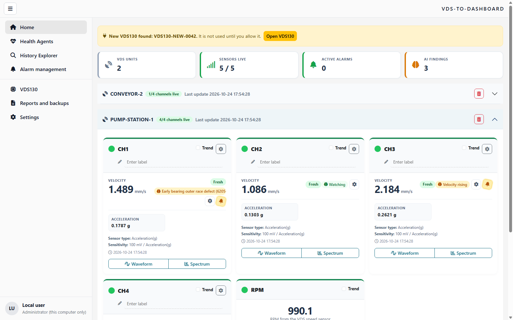
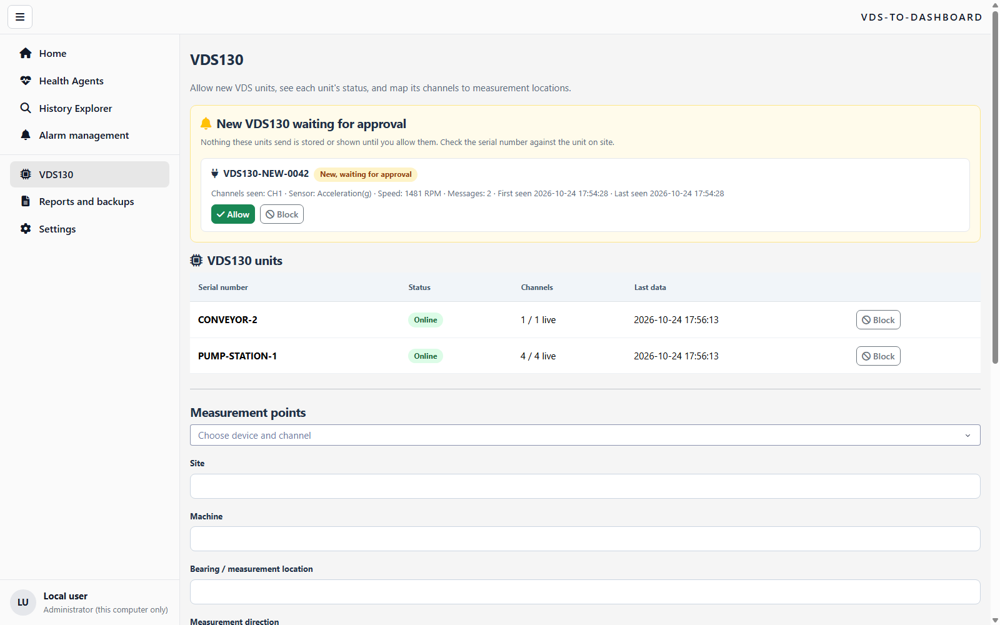
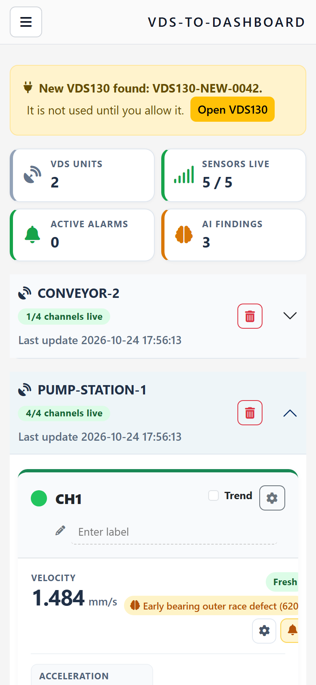
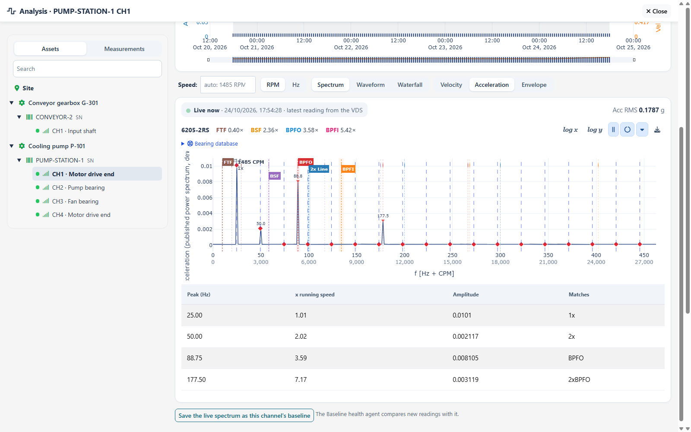
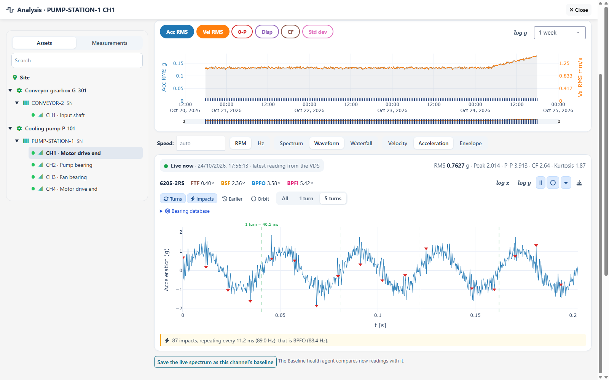
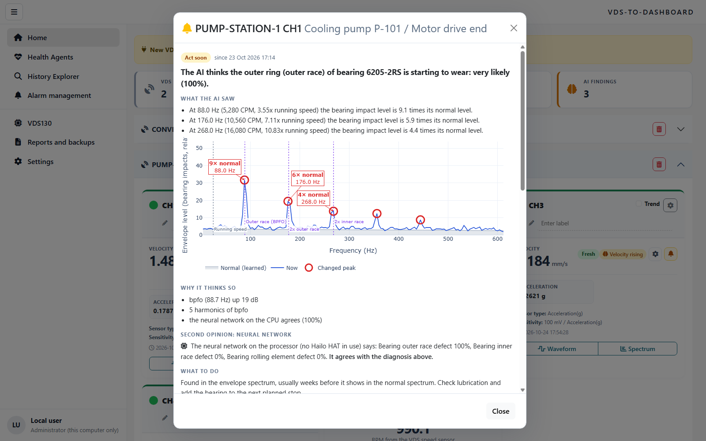
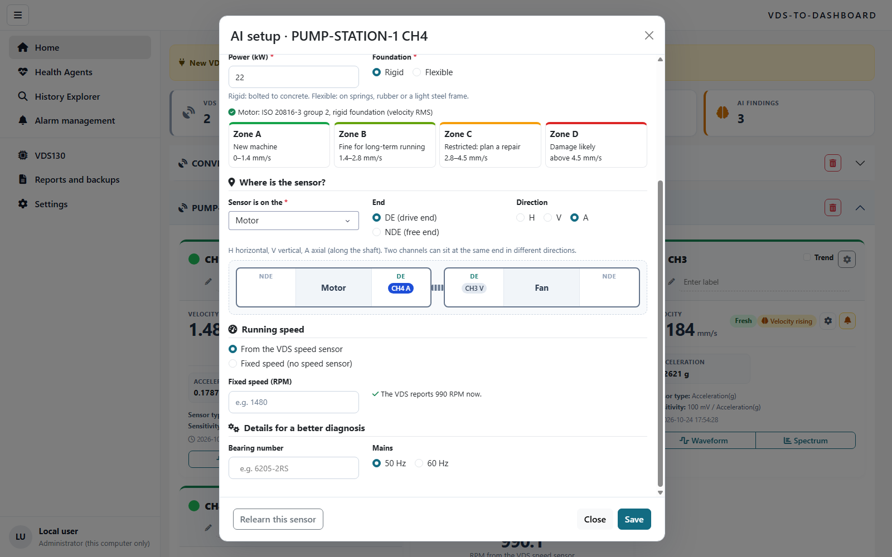
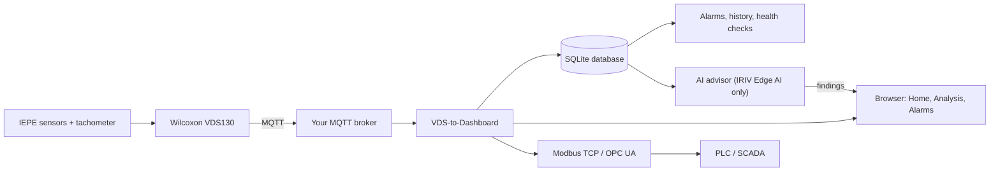
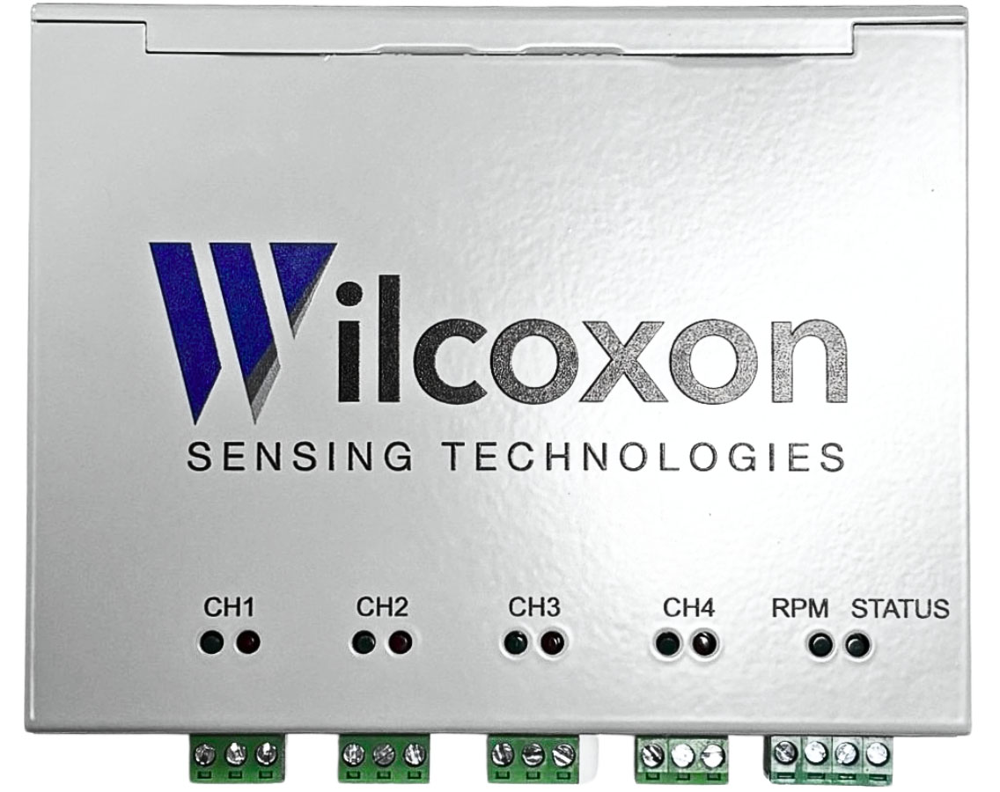
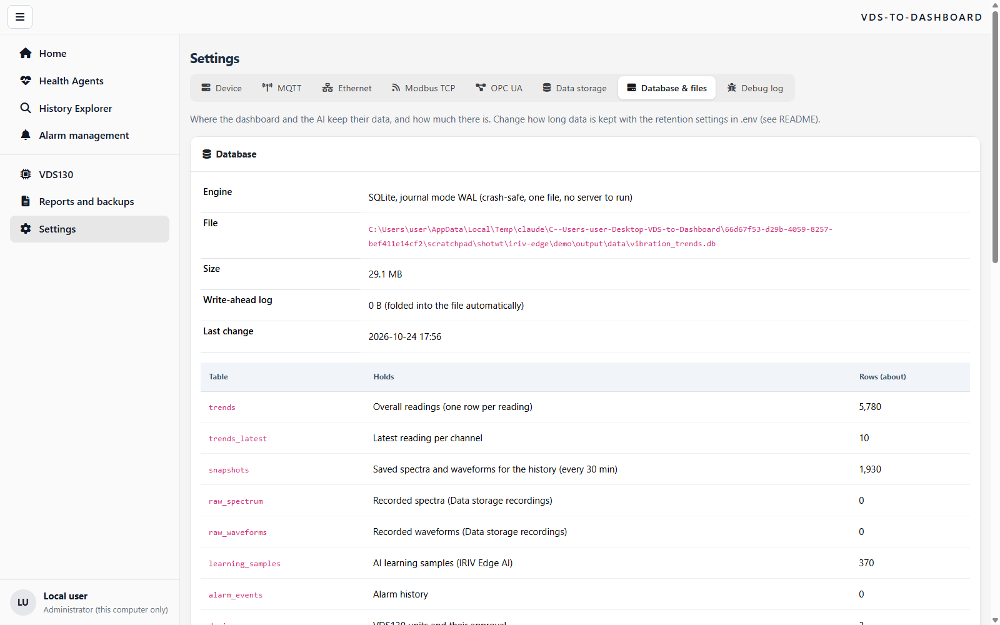

# VDS-to-Dashboard

*Plug-and-play vibration monitoring and diagnostics for the Wilcoxon VDS130.*

[](https://github.com/dineshpalsingh1989/VDS-to-Dashboard/actions/workflows/checks.yml)
[Download for Linux](https://github.com/dineshpalsingh1989/VDS-to-Dashboard/releases/latest) ·
[Container package](https://github.com/dineshpalsingh1989/VDS-to-Dashboard/pkgs/container/wilcoxon-vds) ·
[Source ZIP](https://github.com/dineshpalsingh1989/VDS-to-Dashboard/archive/refs/heads/main.zip) ·
**[Try the live demo →](https://dineshpalsingh1989.github.io/VDS-to-Dashboard/)**

Connect a VDS130 to your MQTT broker, allow it on the dashboard, and it starts
running: live readings for every channel, trends, spectra and waveforms, alarms,
history, backups, and Modbus TCP / OPC UA for your PLC or SCADA. On a Cytron IRIV
Edge AI it also learns each machine's normal vibration and explains in plain words
when something changes.



<sub>All screenshots use synthetic data from the built-in demo, not measurements from production equipment.</sub>

## Contents

- [Quick start](#quick-start) · [Update](#update-in-one-command) · [Connect a VDS130](#connect-a-vds130-plug-and-play)
- [What you get](#what-you-get) · [AI on the IRIV Edge AI](#ai-on-the-cytron-iriv-edge-ai) · [How it works](#how-it-works)
- [Data and storage](#data-and-storage) · [Settings reference](#settings-reference) · [Development](#development)

## Quick start

You need a 64-bit Linux computer (PC, server or Raspberry Pi OS 64-bit) with
[Docker Engine and the Compose plugin](https://docs.docker.com/engine/install/).
Python is inside the container.

```bash
git clone https://github.com/dineshpalsingh1989/VDS-to-Dashboard.git
cd VDS-to-Dashboard
bash scripts/linux-start.sh
```

Open **http://127.0.0.1:8050** and sign in as `admin` with the password the script
saved in `.env` (it is never printed). Then add your broker under
**Settings > MQTT**.

<details>
<summary>Other ways to install: release download, prebuilt image, Windows, IRIV Edge AI</summary>

**Release download with checksum**

```bash
curl -fLO https://github.com/dineshpalsingh1989/VDS-to-Dashboard/releases/latest/download/wilcoxon-vds-linux.tar.gz
curl -fLO https://github.com/dineshpalsingh1989/VDS-to-Dashboard/releases/latest/download/SHA256SUMS
sha256sum --ignore-missing -c SHA256SUMS
tar -xzf wilcoxon-vds-linux.tar.gz && cd wilcoxon-vds
bash scripts/linux-start.sh
```

**Prebuilt image** (no build on the device): `bash scripts/linux-start.sh --image`
pulls `ghcr.io/dineshpalsingh1989/wilcoxon-vds:latest` without a login.

**Cytron IRIV Edge AI**: `bash iriv-edge/install.sh`. It also installs the AI advisor
and, when an AI HAT+ is fitted, the Hailo software. See [iriv-edge/README.md](iriv-edge/README.md).

**Windows (for testing)**: install Python 3.14, then
`python -m venv .venv`, `.venv\Scripts\python -m pip install -r requirements.txt`,
`.venv\Scripts\python app.py`.

**Remote Linux host**: run `ssh -L 8050:127.0.0.1:8050 user@host` on your computer and
open the same address locally. For permanent remote access, put HTTPS in front.

</details>

## Update in one command

```bash
bash scripts/update.sh
```

It fetches the latest version (with `git pull`, or by downloading and checking the
latest release), then restarts the dashboard the same way you started it. Your
`.env`, the database, recordings, backups and the AI's learning are kept. On an
IRIV Edge AI it also updates and restarts the AI advisor.

## Connect a VDS130 (plug and play)

1. Point the VDS130's MQTT output at your broker, and the dashboard at the same
   broker (**Settings > MQTT**).
2. When the unit publishes for the first time, Home shows **"New VDS130 found"**.
   Open **VDS130**, check the serial number, and click **Allow**.
3. With its next message the unit appears on Home and starts running. Click
   **Block** for a unit you do not want; its messages are ignored.

Nothing an unknown unit sends is stored or shown before you allow it. Units that
already sent data before this feature existed are allowed automatically.



## What you get

### Home: everything live

One card per channel with velocity, acceleration and the other readings the VDS
sends, a status pill (fresh, stale, warning, alert), the speed card, and an
overview of units, live sensors, alarms and AI findings. Home redraws only when new
data arrives, and it works on a phone too.

<p align="center"></p>

### Analysis: click Spectrum or Waveform on any channel

The full analysis opens for that channel, starting on the **live** reading:

- **Trend** of any reading (Acc RMS, Vel RMS, peak, displacement, crest factor,
  standard deviation). Click any moment to open the spectrum and waveform saved
  closest to it; one of each is kept every 30 minutes for 90 days.
- **Spectrum** in acceleration, velocity (mm/s) or envelope, with Hz and CPM, the
  strongest peaks named, running-speed harmonics, and the bearing's defect
  frequencies (BPFO, BPFI, BSF, FTF). Type the bearing number, for example 6205-2RS,
  and the lines appear. Fault lines follow the part: a motor shows no gear or blade
  pass.
- **Waveform** with RMS, peak, crest factor and kurtosis, a line at every shaft turn,
  an **impact finder** ("81 impacts, every 11.2 ms = 89.0 Hz: BPFO"), an earlier
  waveform behind today's, zoom to 1 or 5 turns, and an **orbit** when a horizontal
  and a vertical sensor sit at the same bearing.
- **Waterfall** of recent spectra, CSV download, and a searchable bearing database.

| Spectrum with fault lines | Waveform with turns and impacts |
| --- | --- |
|  |  |

### Alarms, history and reports

- **Alarm management**: per-channel, measurement-aware thresholds with hysteresis and
  persistence; events are kept and can be acknowledged.
- **History Explorer**: trends and CSV export. **Reports and backups**: daily reports
  and verified database backups.
- **Health Agents**: connectivity, stale sensors, data quality, disk space and
  baseline changes.
- **Modbus TCP and OPC UA**: chosen values plus data age, validity and communication
  status for your PLC or SCADA.
- **Settings**: Device (serial number, uptime, memory, storage, CPU, IP), MQTT,
  Ethernet, Modbus TCP, OPC UA, Data storage, **Database & files**, Debug log.


## AI on the Cytron IRIV Edge AI

On an IRIV Edge AI the dashboard gains an AI that runs quietly in the background and
never controls a machine:

- **Learns each machine's normal** spectrum, envelope, waveform and readings, then
  watches for change. It does not start until it knows the machine type, power and
  foundation (which give the ISO 20816 / 10816 class) and the running speed.
- **Each channel card** shows a brain (AI off, needs setup, learning 40 %, watching,
  or the fault found), a gear for the **AI setup**, and a **bell** that flashes when
  there is a finding.
- **The bell explains in plain words**: what the AI thinks is wrong and how sure it
  is, what changed ("at 88.8 Hz the vibration went from 0.42 to 2.6 mm/s, about
  6 times normal"), a picture of normal against now, why, what to do, and buttons to
  confirm, reject or mark as repaired. That feedback teaches it.
- **Compares the sensors on one machine** (axial against radial, vertical against
  horizontal, drive end against free end) for misalignment, looseness and where the
  source is.
- **Neural second opinion** on the Hailo AI HAT+, or the processor when there is no HAT.

| The bell: why the AI thinks there is an issue | AI setup with ISO class and sensor positions |
| --- | --- |
|  |  |

Try it on any computer, no hardware needed:

```bash
python iriv-edge/demo/run_demo.py      # simulated plant, opens on http://127.0.0.1:8060
```

Details: [iriv-edge/README.md](iriv-edge/README.md).

## How it works



The VDS publishes to your broker. The dashboard checks every message, keeps its
measurement settings (unit, filter, detection, sensor), and stores it in SQLite.
Message parsing follows the
[VDS130 setup manual, page 10](https://wilcoxon.com/wp-content/uploads/2026/03/VDS130-setup-instructions-97047A.pdf).
Missing readings stay missing rather than becoming zero, and invalid array lengths
are reported, not plotted.

<p align="center"></p>

## Data and storage

- **Database**: SQLite in WAL mode: one crash-safe file, no database server to run.
  **Settings > Database & files** shows the file, its tables and sizes, what is kept
  for how long, and (on IRIV) where the AI keeps its files.

  
- **Backups**: a verified copy of the database every day in `backups/`, plus manual
  backups from **Reports and backups**. Copy them off the device too.
- **Retention**: readings, recordings and acknowledged alarms are kept until you set
  `VDS_TREND_RETENTION_DAYS`, `VDS_RAW_RETENTION_DAYS` or `VDS_ALARM_RETENTION_DAYS`.
  Data covered by an active recording is never pruned.
- **Restore**: stop the dashboard, keep the current database, place a verified backup
  at `<VDS_DATA_DIR>/vibration_trends.db` without old `-wal`/`-shm` files, and start it.
- **Docker**: data lives in the named volume at `/data`. `docker compose ... down`
  keeps it; do not add `--volumes` unless you mean to delete it.

## Settings reference

Set these in `.env` (Docker) or the environment.

| Variable | Default | Purpose |
| --- | --- | --- |
| `VDS_ADMIN_USER` / `VDS_ADMIN_PASSWORD` | admin / generated | Administrator login (required for remote access) |
| `VDS_VIEWER_USER` / `VDS_VIEWER_PASSWORD` | viewer / empty | Optional read-only login |
| `VDS_HOST` / `VDS_PORT` | 127.0.0.1 / 8050 | Address and port of the dashboard |
| `VDS_BIND_ADDRESS` | 127.0.0.1 | Address Docker publishes the dashboard on |
| `VDS_DEVICE_APPROVAL` | 1 | A new VDS waits on the VDS130 page until allowed; 0 accepts every unit |
| `VDS_DATA_DIR` | device_data | Database, backups and reports |
| `VDS_CONFIG_DIR` | app folder | MQTT and Modbus configuration |
| `VDS_SNAPSHOT_INTERVAL_S` / `VDS_SNAPSHOT_RETENTION_DAYS` | 1800 / 90 | Saved spectra and waveforms for the analysis history |
| `VDS_TREND_RETENTION_DAYS` | 0 (keep) | Overall readings |
| `VDS_RAW_RETENTION_DAYS` | 0 (keep) | Recorded waveforms and spectra |
| `VDS_ALARM_RETENTION_DAYS` | 0 (keep) | Acknowledged alarm events |
| `VDS_PROTOCOL_HOST` / `VDS_MODBUS_PORT` | 127.0.0.1 / 502 | Modbus and OPC UA interface; use 1502 unprivileged |
| `VDS_EDGE_AI` | 0 | 1 on IRIV Edge AI: AI setup, findings and learning samples |
| `VDS_LEARNING_INTERVAL_S` / `VDS_LEARNING_RETENTION_HOURS` | 600 / 6 | AI learning samples per channel |
| `VDS_START_MODE` | set by the launcher | `build` or `image`, so `update.sh` restarts the same way |

**Access and safety**

- Viewers can look but cannot change settings, delete data, allow units or give AI
  feedback; the server enforces this.
- Use HTTPS through a reverse proxy for remote access.
- OPC UA is anonymous and Modbus has no login: bind them to a trusted OT network
  only. They are monitoring interfaces, not machine protection.
- Modbus values are big-endian IEEE-754 float32, two holding registers each.
- The AI and health checks are advisory and never issue machine commands.

## Development

```bash
python -m venv .venv && .venv/bin/python -m pip install -r requirements.txt
.venv/bin/python -m unittest discover -s tests -v        # no broker, PLC or sensor needed
.venv/bin/python app.py                                   # http://127.0.0.1:8050
python -m http.server 8080 --directory demo               # the static public demo
```

- Code: `app.py` (services and Home), `vds_dashboard/` (pages, database, analysis,
  AI views), `iriv-edge/` (AI advisor, neural model, IRIV installer), `docker/`, `scripts/`.
- `replay.py` replays captured MQTT messages into a fresh database for commissioning tests.
- Every push to `main` runs the [checks](.github/workflows/checks.yml) on Linux AMD64 and
  ARM64, builds and tests the container, publishes the container package, and
  rebuilds the [public demo](.github/workflows/demo.yml). A `v*` tag publishes a release.
- `AGENTS.md` holds the rules for coding assistants working on this repository.
- PyModbus stays pinned to 2.5.3 until a tested v3 migration exists.

Licensed under MIT; see [LICENSE](LICENSE).
