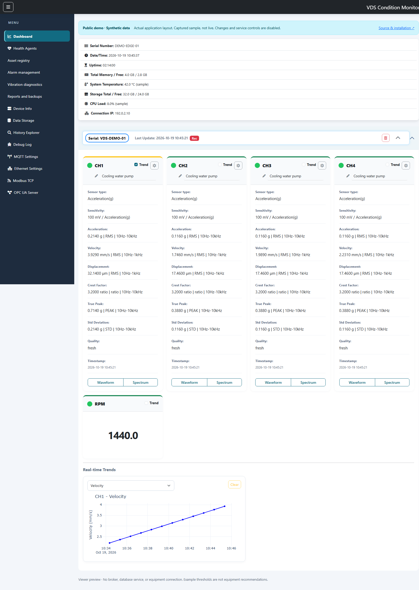
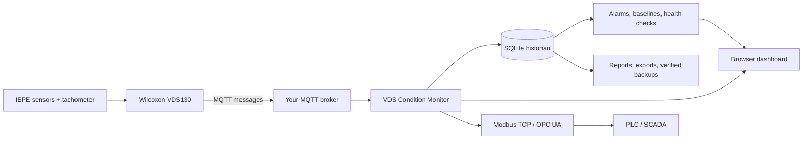
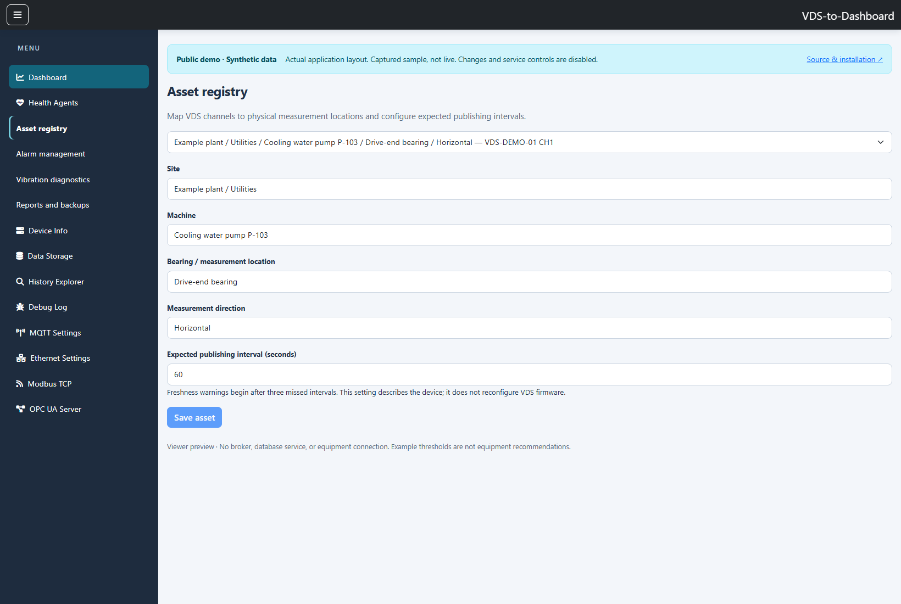
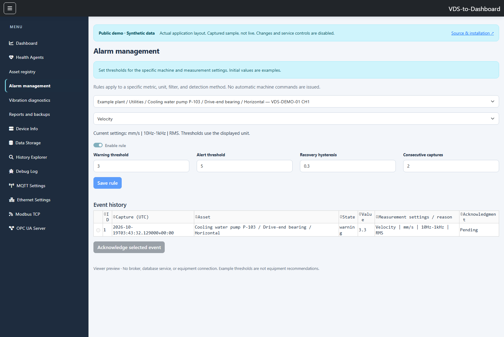
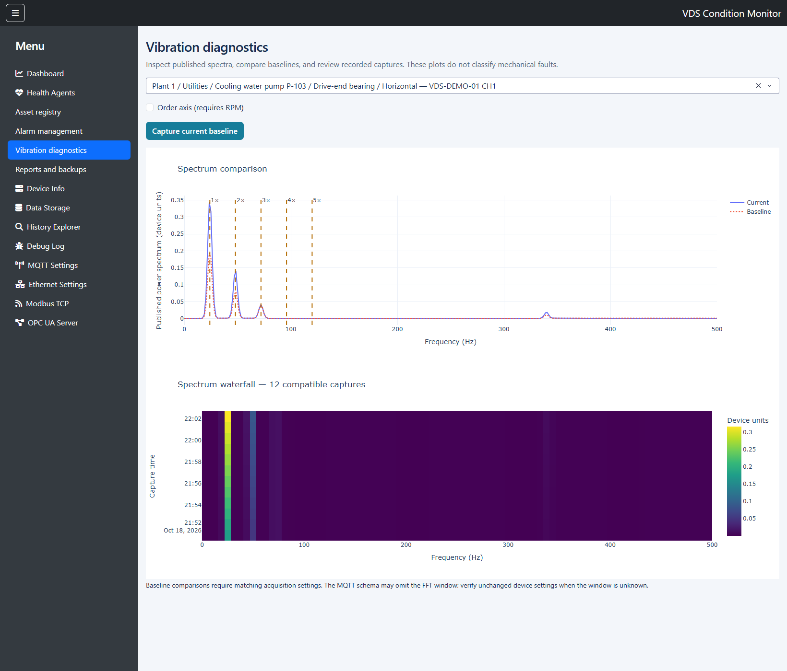

# Wilcoxon VDS Condition Monitor

[](https://github.com/dineshpalsingh1989/Wilcoxon-VDS/actions/workflows/checks.yml)
[Download for Linux](https://github.com/dineshpalsingh1989/Wilcoxon-VDS/releases/latest) · [Container package](https://github.com/dineshpalsingh1989/Wilcoxon-VDS/pkgs/container/wilcoxon-vds) · [Source ZIP](https://github.com/dineshpalsingh1989/Wilcoxon-VDS/archive/refs/heads/main.zip)

**[Open the interactive dashboard demo →](https://dineshpalsingh1989.github.io/Wilcoxon-VDS/)**

Try the real application's layout in your browser with no installation or login.
The demo uses the same dark header, full navigation menu, device accordion,
four measurement cards, RPM card, and Plotly charts. Explore all 14 pages,
toggle channel trends, open waveform/spectrum plots, change the diagnostic
channel/order axis, and download sample history CSV. Data is a captured synthetic
example, not live measurements. Configuration and service controls are disabled.
The preview never connects to equipment or your database.

MQTT ingestion, a SQLite historian, measurement-aware alarms, diagnostic plots,
and advisory health agents for Wilcoxon VDS130 data. The dashboard also exposes
selected values and data quality through Modbus TCP and OPC UA.

## Download and run on Linux

Install [Docker Engine and the Docker Compose plugin](https://docs.docker.com/engine/install/)
first (Compose 2.20 or newer). The container includes Python and the application's
dependencies. Linux AMD64 PCs/servers and ARM64 systems use the same launcher;
32-bit Raspberry Pi operating systems are not supported by the published images.

```bash
curl -fL https://github.com/dineshpalsingh1989/Wilcoxon-VDS/releases/latest/download/wilcoxon-vds-linux.tar.gz -o wilcoxon-vds-linux.tar.gz
curl -fL https://github.com/dineshpalsingh1989/Wilcoxon-VDS/releases/latest/download/SHA256SUMS -o SHA256SUMS
sha256sum --ignore-missing -c SHA256SUMS
tar -xzf wilcoxon-vds-linux.tar.gz
cd wilcoxon-vds
bash scripts/linux-start.sh --build
```

Open **http://127.0.0.1:8050** on that Linux machine. Sign in with `admin` and the
generated `VDS_ADMIN_PASSWORD` saved in `.env`. The launcher keeps that file private
and preserves an existing configuration. Configure your MQTT broker in the dashboard.
For a remote Linux host, run `ssh -L 8050:127.0.0.1:8050 user@linux-host` from your
own computer, then open the same browser address locally.

To download current source without waiting for a release, use **Source ZIP** above,
extract it, and run `bash scripts/linux-start.sh --build` inside its folder.

### Run the prebuilt container package

The published package allows anonymous downloads. Use the same extracted folder with:

```bash
bash scripts/linux-start.sh --image
```

This pulls `ghcr.io/dineshpalsingh1989/wilcoxon-vds:latest` instead of building.
Set `VDS_IMAGE=ghcr.io/dineshpalsingh1989/wilcoxon-vds:1.1.0` in `.env` to pin a
release. No GitHub login is required. If an image download is unavailable, use
`--build` to build from the public source instead.

Stop with `docker compose down`. For image-only installs, use
`docker compose -f compose.image.yaml down`. Keep the named volume to retain
SQLite data. Both Compose files use the project name `wilcoxon-vds`; existing
installs should set `COMPOSE_PROJECT_NAME` to their original project name before
upgrading so they continue using their existing volume.

### What the GitHub language bar means

The Python percentage describes the repository's source-code languages. It is
not an installation requirement or a quality score. Docker bundles Python for
Linux users; **Packages** contains built container images, **Releases** contains
download bundles, and **Actions** shows automated code-check results.



Screenshots use synthetic pump measurements and demonstration identifiers. They
show the actual application; they are not measurements from production equipment.
Click any screenshot to view it at full size.

## How it works



The VDS publishes measurements to your broker. The application validates each
message, preserves its measurement settings, and stores scalar history in SQLite.
Recording jobs also retain raw waveforms and spectra. Operators review trends,
alarm events, and advisory findings through the browser. Docker packages the
application; the database remains SQLite on a persistent volume.

## Visual walkthrough

### 1. Connect and identify the measurement point

Configure the broker in **MQTT Settings** and restart the application. When data
arrives, open **Asset registry**, select a channel, and enter the site, machine,
bearing location, direction, and expected publishing interval. Click **Save asset**.



### 2. Configure and review alarms

Open **Alarm management**, choose a channel and metric, and check the displayed
unit, filter, and detection method. Set machine-specific thresholds, recovery
hysteresis, and consecutive captures, then enable and save the rule. The event
table records transitions; select an event and click **Acknowledge selected event**
to record the operator's review. The screenshot's thresholds are demonstration values.



### 3. Compare spectra and recorded captures

Start a recording in **Data Storage** to retain raw captures. Open **Vibration
diagnostics**, choose a channel, and use **Capture current baseline** when its
operating condition is suitable as a reference. Compare the current spectrum to
that baseline, inspect RPM harmonics, or enable the order axis. The waterfall
shows compatible recorded spectra over time. Select a recorded capture, review its
acquisition details and waveform, inspect the strongest peaks, or click a spectrum
point for frequency, amplitude, and order. Enter Manual RPM when needed. The
screenshot shows the updated order view with a display-only 1200 RPM override.



### 4. Review health and export results

Open **Health Agents** for advisory findings. Use **History Explorer** for trends
and CSV exports, or **Reports and backups** to select a UTC day, download a report,
and create an integrity-checked database backup. Administrator access is required
for changes and acknowledgments; viewer accounts can inspect permitted read-only views.

### The six monitoring checks

| Check | What it reports |
| --- | --- |
| Connectivity | MQTT connection failures |
| Sensor | Missing or stale measurements after three expected publishing intervals |
| Data quality | Missing measurement settings and invalid array lengths |
| Storage | Less than 10% free disk space |
| Baseline | Changes of at least 50% against a compatible saved baseline |
| Health | An overall healthy result when no issues are found |

These are deterministic checks, not independent AI processes. Daily reports,
backups, and retention run in a separate maintenance task. `AGENTS.md` contains
development instructions for coding assistants; it does not start runtime agents.

## Run locally

### Preview the public demo locally

The browser-only demo needs no Python packages or Docker:

```bash
python -m http.server 8080 --directory demo --bind 127.0.0.1
```

Open **http://127.0.0.1:8080**. Source files are in `demo/`. The
[demo workflow](.github/workflows/demo.yml) renders the actual application in an
isolated temporary environment, checks the generated views and Chrome interactions,
then publishes only the static `demo/` folder to GitHub Pages. Application layout
and stylesheet changes trigger regeneration so the demo follows the real UI.
Repository Pages settings must use **GitHub Actions** as the publishing source.

To regenerate the preview locally, install the application dependencies and
Node.js 24, ensure Chrome is installed, then run `node scripts/build-demo.mjs`.
Set `DEMO_PYTHON` to your virtual environment's Python executable if necessary.
The exporter creates synthetic data in a temporary directory and starts no MQTT,
Modbus, OPC UA, or maintenance workers. See [demo maintenance notes](demo/README.md).

### Run the full application

For development without Docker, install Python 3.14. On Linux:

```bash
python3.14 -m venv .venv
.venv/bin/python -m pip install -r requirements.txt
.venv/bin/python app.py
```

On Windows PowerShell:

```powershell
python -m venv .venv
.venv\Scripts\python -m pip install -r requirements.txt
.venv\Scripts\python app.py
```

Open http://127.0.0.1:8050. On Linux, use `.venv/bin/python` instead.
The application uses Waitress with one process and eight HTTP threads.
Configure the broker in MQTT Settings, then restart the application to apply
broker changes. Restart Application restarts Python; it does not reboot the host.

## Docker

```powershell
Copy-Item .env.example .env
# Edit .env and set a strong VDS_ADMIN_PASSWORD before the next command.
docker compose up -d --build
```

Compose reads `.env`; running `python app.py` directly does not load it.
The image runs as UID 10001 with dropped capabilities. Compose uses a read-only
root filesystem, a temporary /tmp, and a persistent named volume at /data.
SQLite, backups, reports, and broker configuration survive container replacement.
The dashboard is published on 127.0.0.1:8050 by default. `/healthz` checks HTTP
process liveness and does not claim that sensors or the broker are connected.

This stack uses SQLite, not PostgreSQL. It does not start an MQTT broker.
Configure the address of your existing broker; `localhost` inside the container
means the container itself. Docker Desktop can reach a host broker using
`host.docker.internal` when the host broker permits that connection.

Industrial protocol ports are not published by the default Compose file. For a
trusted OT network deployment, explicitly configure `VDS_PROTOCOL_HOST`, an
unprivileged Modbus port such as 1502, and the required port mappings. OPC UA and
Modbus endpoints are separate from the dashboard login. No privileged container
or host networking is needed for the default dashboard deployment. Host time
administration is intentionally unavailable inside the restricted container.

Stop the stack with `docker compose down`. Do not add `--volumes` unless you
intend to remove its persisted data.

## Commission a device

1. Configure VDS publishing to your MQTT broker and subscribe through MQTT Settings.
2. Open Asset registry. Map each gateway/channel to site, machine, bearing location,
   and measurement direction. Enter the device's expected publishing interval.
3. Check Health Agents and the measurement cards for timestamp, metadata, and
   array-length issues before using the data for alarms or comparisons.
4. Open Alarm management. Select a metric, review its published unit, filter, and
   detection method, then set machine-specific warning/alert thresholds,
   hysteresis, and consecutive-capture persistence. Initial thresholds are examples.
5. Start a recording to retain raw waveforms and spectra. Scalar history is
   continuous, whether or not a recording job is active.
6. Open Vibration diagnostics to save a baseline, overlay spectra, inspect RPM
   harmonics/order axes, and view a waterfall of compatible recorded spectra.

Freshness is based on three missed publishing intervals, not the browser refresh
rate. The default interval is 60 seconds, so the default stale threshold is 180
seconds. Asset settings describe the VDS; they do not change device firmware.

## Measurement integrity

The parser follows the MQTT content documented in the
[VDS130 setup manual, page 10](https://wilcoxon.com/wp-content/uploads/2026/03/VDS130-setup-instructions-97047A.pdf).
It preserves metric units, detection, and filters; sensor type/sensitivity; capture
and receipt timestamps; and waveform/spectrum acquisition settings when supplied.
`StandardDeviation` is read from the device, rather than replaced by a different
calculation. Missing metrics remain missing, rather than becoming zero.

Waveform length is checked against duration x sampling frequency when supplied;
spectra require lines + 1 samples including the DC bin. Invalid lengths produce
quality findings and are not presented with fabricated plot axes. The test
fixtures contain small synthetic examples shaped after the documented schema;
they are not recordings from the user's hardware.

Duplicate captures do not advance alarm persistence. Older captures may enter
history but do not replace newer live metric values. Alarm state and transitions
are durable. A unit/filter/detection change puts a rule into an unknown state until
reviewed. Acknowledgment records the user and time; it does not clear a fault.

History plots separate incompatible measurement settings, and CSV/Excel exports
include context. Legacy rows without context remain explicitly unknown. Baseline
spectrum comparisons require matching acquisition settings. The published power
spectrum is plotted in device units without an assumed amplitude conversion.
The MQTT schema may omit the window function; verify unchanged VDS settings when
that field is unavailable. RPM order plots use the RPM attached to the capture;
they are not tachometer-resampled order tracking.

Health Agents provide connectivity, data-quality, freshness, storage, and
baseline-change findings. Baseline changes of 50% or more are advisory and include
reference/current values. Reports group measurements by their settings. None of
these features classifies mechanical faults or issues machine commands.

## Storage, backup, and retention

Scheduled maintenance runs once per UTC day, starting on application launch:

- Create a SQLite backup and check its integrity before enabling any pruning.
- Generate the previous UTC day's Markdown report under `reports/`.
- Apply configured retention; 0 means keep all data.

Backups live under `backups/` in VDS_DATA_DIR. The Reports and backups page also
creates a verified manual backup and provides on-demand reports, including today.
Download backups to separate storage; local copies do not protect against disk loss.
Automatic backups/reports themselves are retained until archived by the operator.

Raw/scalar pruning preserves data covered by active recording jobs. Alarm retention
removes only acknowledged events. Retention does not reinterpret legacy local
timestamps. New context includes epoch capture times and UTC report/export fields.
A future migration of legacy timestamps requires knowing their original timezone.

To restore, stop the application, preserve the current database and its sidecars,
then place a verified backup at VDS_DATA_DIR/vibration_trends.db with ownership
that permits the service user to write. Do not combine a restored database with
old -wal/-shm sidecars. Restart and verify channels, rules, and recording jobs.

The upgrade adds tables and context columns without dropping historical tables.
Plain legacy pickled configuration is restricted to non-executable objects and
migrated to JSON. Old dashboard alarm thresholds remain in configuration but must
be re-entered in Alarm management with verified measurement settings.

## Environment and access

| Variable | Default | Purpose |
| --- | --- | --- |
| VDS_HOST / VDS_PORT | 127.0.0.1 / 8050 | Native HTTP bind address/port |
| VDS_ADMIN_USER / VDS_ADMIN_PASSWORD | admin / empty | Password is required for remote access |
| VDS_VIEWER_USER / VDS_VIEWER_PASSWORD | viewer / empty | Optional read-only account |
| VDS_PROTOCOL_HOST | 127.0.0.1 | Industrial protocol interface |
| VDS_MODBUS_PORT | 502 | Set 1502 for an unprivileged deployment |
| VDS_DATA_DIR | device_data beside app.py | Database, backups, reports |
| VDS_CONFIG_DIR | directory containing app.py | MQTT/Modbus configuration |
| VDS_TREND_RETENTION_DAYS | 0 | Scalar history retention |
| VDS_RAW_RETENTION_DAYS | 0 | Waveform/spectrum retention |
| VDS_ALARM_RETENTION_DAYS | 0 | Acknowledged alarm retention |
| VDS_BIND_ADDRESS | 127.0.0.1 | Compose host publication address |

Use HTTPS through a reverse proxy for remote access: HTTP Basic credentials need
encrypted transport. Viewer writes are blocked on the server even if controls
remain visible. OPC UA currently uses anonymous access; bind industrial listeners
to a trusted network. Dashboard credentials do not protect these protocols.
Run one application process, not multiple WSGI workers with separate device state.

Modbus uses big-endian IEEE-754 float32, two holding registers per mapping. In
addition to metrics/RPM, choose Data Age (seconds; -1 is unknown), Data Valid (0/1),
and Communication Status (0/1) for a channel. Always inspect quality alongside
numeric values; a numeric fallback of zero is not proof of a valid measurement.
OPC UA adds read-only DataAgeSeconds, DataValid, CommunicationStatus, and per-metric
Settings JSON nodes under each channel. IDs are stable within the registered
namespace. These gateways remain monitoring interfaces, not machinery protection.

## Development and replay

```powershell
.venv\Scripts\python -m unittest discover -s tests -v
.venv\Scripts\python -m compileall -q app.py runtime.py vds.py historian.py diagnostics.py workspace_views.py monitoring.py replay.py
.venv\Scripts\python replay.py tests/fixtures/vds130_messages.json --data-dir .review/replay --rebase-time --record-raw
```

Replay refuses an existing database and starts no hardware services. Captured
JSON can replace the synthetic fixture for commissioning tests. Keep credentials
out of captures. Tests use temporary databases and mock protocol listeners; they
do not connect to physical sensors or PLCs. CI runs tests and builds the image.

## GitHub code checks and downloads

[Dashboard checks](https://github.com/dineshpalsingh1989/Wilcoxon-VDS/actions/workflows/checks.yml)
runs on pushes to `main`, pull requests, version tags, and manual requests:

- Check dependency compatibility, Python syntax, and undefined names.
- Run the test suite on Linux AMD64 and ARM64 runners with Python 3.14.
- Check Linux shell syntax, build the production image, and run an isolated
  non-root container test for startup, HTTP routes, and verified backups.
- Validate both Compose configurations.
- Publish AMD64/ARM64 container packages only after checks pass, outside pull requests.
- On a `v*` tag, publish a Linux source bundle and SHA-256 checksums as a GitHub Release.

The published AMD64 and ARM64 images have been verified to allow anonymous pulls.
Maintainers publishing a fork should check its package visibility separately;
GitHub can create new packages as private. Checks exercise software behavior;
commissioning against real VDS hardware is still required for a new installation.

Modules: vds.py normalizes measurements; historian.py persists context, rules,
backups and retention; diagnostics.py builds plots/exports; workspace_views.py
contains the new pages; monitoring.py provides advisory agents; app.py integrates
hardware services and the original dashboard.

PyModbus is pinned to 2.5.3 until a separately tested v3 API migration is completed.
Licensed under MIT; see LICENSE.

### Diagnostic exploration

- View time waveforms and spectra together with capture time, sampling rate, frequency resolution, FFT window, and RPM source.
- Choose **Live / latest** or one of the latest 100 recorded timestamps. Historical spectra compare against the saved channel baseline when acquisition settings match. The baseline button always captures the live spectrum.
- Click a spectrum point to inspect frequency, amplitude, and order. The peak table ranks up to ten local maxima, excluding DC and endpoints, using original spectrum bins without interpolation.
- Enable the order axis to use capture RPM, or enter a positive **Manual RPM** for the spectrum and baseline display. This is a frequency-axis conversion, not speed-synchronised order tracking. The waterfall remains in Hz.
- Review a responsive dashboard with wider channel cards, clearer measurement labels, consistent controls, and acquisition detail panels.

Recorded values are unchanged. Waveforms and spectra are paired only at identical stored timestamps; missing data is shown as unavailable. Legacy recordings may lack RPM, FFT window, or UTC capture metadata; these remain unknown rather than being inferred from live readings. Spectrum amplitudes remain in published device units, and waveform amplitudes remain in sensor units.

The public demo includes the same diagnostic exploration with synthetic captures, manual RPM, peak inspection, and baseline comparisons. All configuration and service actions remain disabled. See [demo instructions](demo/README.md).
